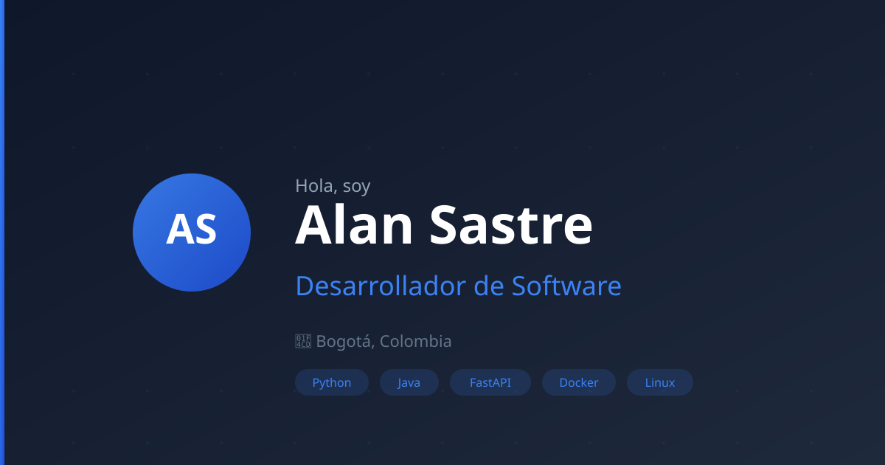

 

 

### Desarrollador de Software · Backend · Ciberseguridad · IA

📍 Bogotá, Colombia &nbsp;·&nbsp; 🎓 Ingeniería de Sistemas (2022–2026)

---

## 👋 Hola, soy Alan

Soy desarrollador de software con más de **3 años de experiencia** diseñando y construyendo APIs REST con Python y Java, trabajando con bases de datos SQL y NoSQL. Mi pasión reside en el **desarrollo backend**, la **ciberseguridad ofensiva** y la **integración de inteligencia artificial** en productos reales.

Me enfoco en escribir código limpio, escalable y bien documentado. Creo firmemente en la colaboración, el aprendizaje continuo y compartir conocimiento con la comunidad.

Además de programar, he participado como **ponente en charlas y eventos universitarios sobre Linux**, promoviendo el software libre y el open source.

---

## 💼 Experiencia profesional

### 🎮 RobCodePlay — Desarrollador de Videojuegos Educativos
*Feb 2025 – Oct 2025*

Desarrollo de videojuegos educativos con Phaser y JavaScript, enfocados en enseñar programación de forma interactiva.

### 💻 InnovaTech — Programador Backend
*Nov 2024 – May 2025*

Implementé la lógica de disponibilidad y asignación de horarios para sistemas de gestión interna usando Django y Python.

### 🏥 DataSoft Colombia — Desarrollador Backend
*Jan 2023 – Jan 2024*

Desarrollo de APIs REST con Spring Boot y MySQL para sistemas de gestión de reservas médicas.

---

## 🚀 Proyectos destacados

| Proyecto | Descripción | Tecnologías |
|----------|-------------|-------------|
| **[Gestor de Salones](https://github.com/Alan-sastre/gestor-salones)** | Sistema web para reservar salones y equipos universitarios | React, Vite, Supabase, Tailwind |
| **[Dopamine](https://github.com/Alan-sastre/Dopamine)** | Quickshell para Hyprland con navegación y barra interactiva | QML, Qt, Hyprland, Linux |
| **[Git-Mastery](https://github.com/MikaStiebitz/Git-Mastery/pull/91)** | Contribución open source a plataforma interactiva de aprendizaje de Git | Next.js, TypeScript, Tailwind |
| **[Pentest Labs](https://github.com/Alan-sastre)** | Entornos de práctica para pruebas de penetración y ciberseguridad | Python, Docker, Linux, OWASP |
| **[NotiCode](https://github.com/Alan-sastre)** | Plataforma de notificaciones y comunicación en tiempo real | Python, FastAPI, WebSocket, Docker |
| **[ExtractorCorreos](https://github.com/Alan-sastre/ExtractorCorreos)** | Herramienta para extraer emails de archivos y texto | Python, Regex, Linux |

---

## 🛠️ Habilidades técnicas

### ⚙️ Backend
Python · Java · SQL · FastAPI · Spring Boot · Django · PostgreSQL · MySQL

### 🎨 Frontend
JavaScript · TypeScript · React · Tailwind CSS · HTML/CSS

### 🛠️ Herramientas
Git & GitHub · Linux · Docker · Supabase · Ciberseguridad

---

## 🎓 Certificaciones destacadas

| Certificación | Emisor | Año |
|--------------|--------|-----|
| 🥇 Pentesting — Pruebas de Penetración | Universidad de los Andes | 2024 |
| 🥇 Introduction to Backend Development | Meta (Coursera) | 2024 |
| 🥇 Python for Everybody | University of Michigan (Coursera) | 2024 |
| 🥇 Cybersecurity | Cisco Networking Academy | 2024 |
| 🥇 Python | MIC TIC | 2024 |
| JavaScript | Platzi | 2024 |
| Git & GitHub | Platzi | 2024 |
| Linux | Platzi | 2024 |

*+9 certificaciones más disponibles en el portafolio*

---

## 📬 Contacto

¿Tienes una oportunidad, proyecto o idea en mente? ¡Hablemos!

| Canal | Enlace |
|-------|--------|
| 📧 Email | [alan.sastre1@gmail.com](mailto:alan.sastre1@gmail.com) |
| 💼 LinkedIn | [linkedin.com/in/alan-sastre](https://linkedin.com/in/alan-sastre) |
| 🐙 GitHub | [github.com/Alan-sastre](https://github.com/Alan-sastre) |

---

### ⚡ Stack del portafolio

React · TypeScript · Tailwind CSS · Vite · Vercel

Hecho con ❤️ en Bogotá, Colombia

